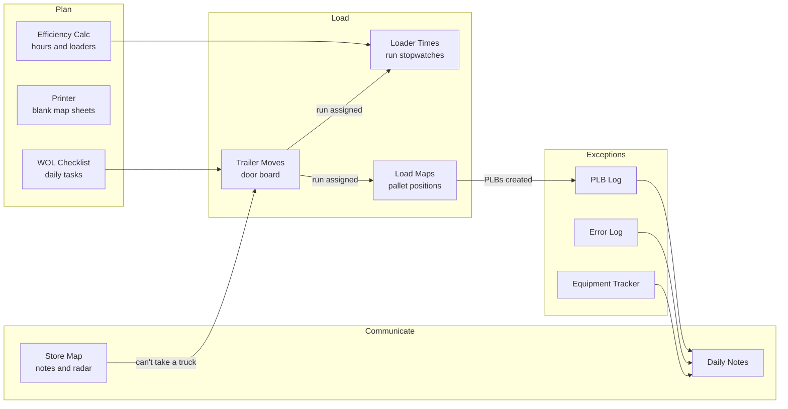
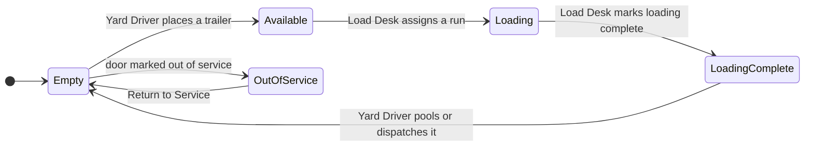

<div align="center">

# 🚛 LOX LOAD DASH

### The operations command center for the Loxley Load Team

**Eleven connected web apps that run outbound loading at the Loxley Distribution Center: trailers, runs, pallets, people, equipment and stores, all live and on every device.**

[app.loxload.com](https://app.loxload.com) · 


</div>

---

## Contents

- [What it is](#what-it-is)
- [The app suite](#the-app-suite)
- [How the apps work together](#how-the-apps-work-together)
- [A shift with LOX LOAD DASH](#a-shift-with-lox-load-dash)
- [App details](#app-details)
- [Built for the dock floor](#built-for-the-dock-floor)
- [Architecture](#architecture)
- [Deployment](#deployment)
- [Security checklist](#security-checklist)
- [Roadmap: the full potential](#roadmap-the-full-potential)
- [Documentation](#documentation)

---

## What it is

Outbound loading runs on a lot of moving parts: which trailer is on which door, which run is loading, who is loading it, how long it's taking, which pallets got left behind, which selector built a bad pallet, where the stackers went, and which stores can't take a truck today. That information often lives on whiteboards, clipboards, radio calls and memory.

**LOX LOAD DASH puts it all in one place.** It's a set of focused, phone-first web apps, each doing one job well, launched from a single home screen at **app.loxload.com**. Every app is shared and live, so the Yard Driver's phone, the Load Desk PC and the dock tablet all see the same state at the same moment.

| | |
|---|---|
| 📱 **Works on any device** | Phone, tablet or desk PC. Each app can be installed to the home screen as a PWA. |
| ⚡ **Live** | Changes appear on every screen within seconds, through WebSockets or server-sent events. |
| 📷 **Scan-first** | Camera barcode and QR scanning for oLPN labels, with fallback to a hardware scanner or typing. |
| 🧾 **Paper-ready** | Every log exports to PDF or Excel, and several apps archive themselves each day. |
| 🌙 **Dark, high-contrast UI** | Readable under dock lighting and on a scratched tablet screen. |
| 💸 **Low cost** | Self-hosted on one VPS behind nginx, using free data sources (NEXRAD radar, Census geocoding). |

---

## The app suite

| # | App | Address | Job |
|:-:|---|---|---|
| 🏠 | **LOX LOAD DASH** | `app.loxload.com` | Home screen with a live clock and one tile per app |
| 1 | **Daily Notes** | `comms.loxload.com` | Shift notes, WOL assignments, photos, daily PDF archive |
| 2 | **PLB Log** | `plblog.loxload.com` | Pallets Left Behind, scanned and shared live, exported to PDF |
| 3 | **Error Log** | `error.loxload.com` | Selector pallet errors with photos and coaching follow-up |
| 4 | **Trailer Moves** | `yard.loxload.com` | Live door board for doors 10–49, Yard Driver ↔ Load Desk |
| 5 | **Loader Times** | `tracker.loxload.com` | Per-loader run stopwatches and the team scoreboard |
| 6 | **Efficiency Calc** | `ops.loxload.com` | Staffing plan and load-efficiency calculator (0.67 target) |
| 7 | **WOL Checklist** | `checklist.loxload.com` | The 21-task daily Load Team checklist with PDF archive |
| 8 | **Load Maps** | `loadmap.loxload.com` | Tablet planner that maps each pallet position on a trailer |
| 9 | **Equipment Tracker** | `equipment.loxload.com` | Inventory of trucks, stackers, scrubbers, dock plates and sleds, with an audit trail |
| 10 | **Printer** | `print.andytalbert.com` | Numbered blank load map sheets as a PDF |
| 11 | **Store Map** | `map.loxload.com` | 112 division stores with delivery notes, directions and live radar |

<table>
<tr>
<td align="center"><br><sub><b>Trailer Moves</b></sub></td>
<td align="center"><br><sub><b>Loader Times</b></sub></td>
<td align="center"><br><sub><b>Load Maps</b></sub></td>
<td align="center"><br><sub><b>Store Map</b></sub></td>
</tr>
<tr>
<td align="center"><br><sub><b>Daily Notes</b></sub></td>
<td align="center"><br><sub><b>Error Log</b></sub></td>
<td align="center"><br><sub><b>Equipment Tracker</b></sub></td>
<td align="center"><br><sub><b>WOL Checklist</b></sub></td>
</tr>
</table>

---

## How the apps work together

Each app stands on its own, but together they cover the whole life of an outbound load, from planning to dispatch.



### The door life cycle (Trailer Moves)



---

## A shift with LOX LOAD DASH

| When | What happens | Apps |
|---|---|---|
| **Shift start** | Set the WOL assignments, hold the turnover meeting, and fill in the checklist supervisor | Daily Notes, WOL Checklist |
| **Morning setup** | Plan hours and loaders, set the run goal and loader list, and print map sheets | Efficiency Calc, Loader Times, Printer |
| **Before first wave** | Yard Driver puts trailers on every open door, and they show as *Available* at the desk right away | Trailer Moves |
| **Loading** | The desk assigns runs, loaders start their stopwatches, and pallets are mapped position by position | Trailer Moves, Loader Times, Load Maps |
| **As it happens** | PLBs are scanned, bad pallets are photographed, equipment moves are logged, and store notes and weather are checked | PLB Log, Error Log, Equipment, Store Map |
| **Loads finish** | *Loading Complete* flashes on the driver's screen, and the trailer is pooled or dispatched | Trailer Moves |
| **Shift change** | Handoff notes are highlighted and outstanding tasks reviewed | Daily Notes, WOL Checklist |
| **End of day** | PDFs are exported, efficiency is scored, and the yard archive saves itself at 11:55 PM | PLB Log, WOL Checklist, Efficiency Calc |

---

## App details

<details open>
<summary><b>1 · Daily Notes</b> (comms.loxload.com)</summary>

- One page per calendar day, titled with the date, plus a live Central Time clock and a **shift badge** (1st shift until 3:30 PM, then 2nd).
- **WOL Assignments** card for 1st Shift, Mid-Shift, 2nd Shift and Loading WOL. The app asks for any that are missing when the day opens.
- **Quick-add notes** with name, text and up to **4 photos**. Each note gets a permanent timestamp.
- **Highlight** important notes in yellow, and edit or delete with confirmation.
- **Export to PDF** for today, plus **Saved Notes**, an archive of every past day with its own PDF.
</details>

<details>
<summary><b>2 · PLB Log</b> (plblog.loxload.com)</summary>

- Log Store, oLPN, Zone (AMB, CHL, DP, FRZ, BRD) and OCL in seconds.
- **Camera scanning** with the browser's BarcodeDetector API (Code 128, EAN, UPC, ITF, QR, Data Matrix). It handles the GS1 `(00)` prefix and keeps the 18-digit SSCC.
- **Live list** through server-sent events, so new PLBs appear on every screen without a refresh.
- **Export as PDF** in the browser (jsPDF + AutoTable) for the end-of-shift snapshot and carrier handoff.
</details>

<details>
<summary><b>3 · Error Log, "Pallet Police"</b> (error.loxload.com)</summary>

- Document a pallet issue with a scanned oLPN, store, zone, OCL, **selector ID**, **2 pallet photos**, **1 label photo** and notes.
- Coaching workflow: **Needs Follow-up → Followed up with → Needs more training → Repeat Offender**, with a color-coded edge on each card.
- **Search everything** (store, zone, oLPN, selector, notes, status) to pull up one selector's history.
- Live updates through server-sent events.
</details>

<details>
<summary><b>4 · Trailer Moves</b> (yard.loxload.com)</summary>

- A live board for **doors 10–49** with role-based views. The **🚛 Yard Driver** places and removes trailers, and the **📋 Load Desk** assigns runs and loading status.
- Each role sees only its own actions and instructions. Doors that need that role's attention **flash**.
- Status tiles (Available, Loading, Loading Complete, Empty, Out of Service), search, a status filter, and **time-in-status** on every door.
- **Pooled trailers** stay on site until dispatched. **Out-of-service doors** show a red *DO NOT PLACE A TRAILER* warning.
- **Edit Door** opens on double-click or press-and-hold, with rules enforced. Every manual correction is logged.
- **Conflict-safe saves**: each change carries an expected version, so two people can't overwrite each other.
- Exports to Excel and PDF, plus **Daily Archives** saved automatically every night at 11:55 PM Central.
</details>

<details>
<summary><b>5 · Loader Times / Run Tracker</b> (tracker.loxload.com)</summary>

- A scoreboard with **Total Runs, Completed, Remaining and Overall Avg**.
- **Tap a loader's card** to start the stopwatch, and tap again to stop and count the run. A **gong** plays (made with WebAudio, no audio file needed).
- Stopwatches are stored on the server, so they survive refreshes and show the same on every screen.
- **Admin panel**: set the daily run goal, Reset Counts, **Undo Last Tap**, and manage the loader roster (counts are kept when a name matches).
</details>

<details>
<summary><b>6 · Efficiency Calc / Load Tools</b> (ops.loxload.com)</summary>

- **Daily Plan**: Hours = (Runs + Diversions) ÷ 0.67 + 0.5 × Backhauls. Loaders = Hours ÷ 8. The run split is 65% / 35% between shifts.
- **Load Efficiency**: (Runs + Diversions) ÷ (Hours − 0.5 × Backhauls), shown with the full math.
- Runs entirely in the browser and works offline.
</details>

<details>
<summary><b>7 · WOL Checklist</b> (checklist.loxload.com)</summary>

- The **21-task** Load Team checklist: 16 tasks for Shift 1 and 5 for Shift 2, tagged Daily, 3× Daily, Hourly, As Needed or Bi-weekly.
- Repeating tasks count up (0/3 → 3/3). Each task has an **Assignee** and **Note** field that save automatically.
- A day-progress bar, **Save PDF Now**, and a **PDF Archive** of past days.
</details>

<details>
<summary><b>8 · Load Maps</b> (loadmap.loxload.com)</summary>

- **Tablet Load Planner**: 30 positions in left/right pairs, from the trailer nose to the doors.
- Two taps per pallet: **store** (from up to 4 quick-pick buttons) and then **one or two zones**. Mixed pallets show both colors.
- **Save & next** jumps to the next empty position. You can mark a **bulkhead** after any position.
- Load details (fuel, temp, driver, PLBs loaded/created, rebuilds, rewraps, consolidations), **4 sanitary-transport checks**, and loader and driver notes.
- An **automatic pallet count** by zone.
- **Offline drafts** are saved on the device and upload once you're back online, so a dead spot on the dock doesn't lose a map.
- **Print / PDF**, a dated **Archive**, and **JSON download** for each map.
</details>

<details>
<summary><b>9 · Equipment Tracker</b> (equipment.loxload.com)</summary>

- Inventory of Trucks, Stackers, Scrubbers, Dock Plates and Sleds, with serial, owner/unit, brand, status, location (warehouse or store code), Air Tag and notes.
- Status tiles (Working, Needs Repair, In Maintenance, WH, Out of Commission), search, a status filter, and **Export to Excel**.
- A full **Audit Trail** for each item, with every field change shown as old → new and a timestamp.
- **Live Sync** across devices.
</details>

<details>
<summary><b>10 · Printer</b> (print.andytalbert.com)</summary>

- Enter a date and a number of runs (up to 300) to get one PDF of numbered, dated blank load map sheets.
- **Recent Files** keeps every PDF so you can print it again.
</details>

<details>
<summary><b>11 · Store Map</b> (map.loxload.com)</summary>

- **112 stores** across AL, MS, LA, FL and GA on **Mapbox GL**, with Street, Dark and Satellite basemaps and **3D tilt and rotate**.
- Search by code, city, address or ZIP, plus a state filter and *Fit results*.
- **Shared delivery notes** for each store, and an **UNABLE TO RECEIVE TRUCK** flag shown as a red `!` pin. Notes sync for everyone every 5 seconds.
- **Get directions** opens Google Maps.
- **Live NEXRAD radar** from the Iowa Environmental Mesonet, free with no API key. It refreshes every 5 minutes and has a 50-minute loop.
- Add custom locations by pasting coordinates or picking a point on the map, back up and restore notes and locations, and export the full store list to CSV.
</details>

---

## Built for the dock floor

- **Big touch targets** that work with gloves, and press-and-hold instead of fragile double-taps on phones.
- **Role-aware screens** that show each person only what they need to do next.
- **Flashing attention states** so nobody has to hunt for the door that needs them.
- **Scan, then type**: every oLPN field accepts a camera scan, a keyboard-wedge scanner or typing.
- **Works when the signal drops**: Load Maps keeps working offline, and Trailer Moves pauses edits instead of saving bad data.
- **Paper trail by default**: PDFs, Excel exports, daily archives and audit logs.

---

## Architecture

```
                         ┌──────────────── Phones · Tablets · Desk PCs (PWA) ───────────────┐
                         │   HTTPS  +  WebSocket (Socket.io)  +  Server-Sent Events          │
                         └───────────────────────────────┬───────────────────────────────────┘
                                                         │
                                   ┌─────────────────────▼─────────────────────┐
                                   │   nginx  (TLS, one server block per app)   │
                                   └─┬────┬────┬────┬────┬────┬────┬────┬────┬─┘
                                     │    │    │    │    │    │    │    │    │
   app  comms  plblog  error  yard  tracker  ops  checklist  loadmap  equipment  map   ← subdomains
                                     │
                         each app = its own small service + its own data store
                                     │
       External: Mapbox GL tiles · Iowa Environmental Mesonet NEXRAD · Google Maps directions
```

| Concern | Approach |
|---|---|
| **Isolation** | One app per subdomain and service. If one goes down or gets updated, the others keep running. |
| **Real-time** | Socket.io for Trailer Moves, Loader Times and Equipment. Server-sent events for PLB Log and Error Log. A 5-second poll for Store Map notes. |
| **Concurrency** | Versioned writes on the door board (`expected_version` → `STALE_EDIT`). |
| **Persistence** | A server-side store for each app (for example SQLite through better-sqlite3 for Equipment), with photo uploads on disk. |
| **Offline** | Service-worker PWAs. Load Maps queues drafts in `localStorage` and syncs them later. |
| **Documents** | Server-side PDFs (Daily Notes, Checklist, Printer, Yard) and in-browser PDFs (PLB Log via jsPDF). Excel through the Yard and Equipment exports. |
| **Scanning** | The browser BarcodeDetector API with the rear camera, GS1/SSCC normalization, and a keyboard-wedge fallback. |
| **Maps and weather** | Mapbox GL Standard style. IEM NEXRAD `n0q` raster tiles with a cache key that changes every 5 minutes. |

---

## Deployment

Every app is a separate site behind nginx on one VPS. A typical server block looks like this:

```nginx
server {
    listen 443 ssl http2;
    server_name yard.loxload.com;

    ssl_certificate     /etc/letsencrypt/live/loxload.com/fullchain.pem;
    ssl_certificate_key /etc/letsencrypt/live/loxload.com/privkey.pem;

    client_max_body_size 25m;                # photo uploads

    location / {
        proxy_pass         http://127.0.0.1:3004;
        proxy_http_version 1.1;
        proxy_set_header   Upgrade $http_upgrade;     # Socket.io / WebSockets
        proxy_set_header   Connection "upgrade";
        proxy_set_header   Host $host;
        proxy_set_header   X-Forwarded-For $proxy_add_x_forwarded_for;
        proxy_set_header   X-Forwarded-Proto $scheme;
        proxy_buffering    off;                       # server-sent events
        proxy_read_timeout 3600s;
    }
}
```

Run each service under a process manager (pm2 or systemd) so it restarts automatically, and renew TLS with certbot. Back up each app's database and upload folders every night.

> Ports and paths above are examples. Match them to each app's actual service.

---

## Security checklist

- [ ] Set **`ADMIN_PIN`** for Loader Times. If it's blank, anyone with the link can reset counts.
- [ ] Add a **confirmation** to PLB Log deletes, which currently happen with one tap.
- [ ] Put the admin and archive routes behind a PIN, nginx basic auth, or an IP allowlist for the DC network.
- [ ] Keep the Mapbox token **URL-restricted** to `map.loxload.com`.
- [ ] Back up the databases and photo folders nightly, and test a restore.
- [ ] Enable HSTS and keep nginx and Node up to date.

---

## Roadmap: the full potential

The suite already covers the whole outbound loading floor. The biggest gains now come from **connecting the apps** so data is entered once and flows everywhere.

### 🔗 Integration
- **Assigning a run creates a load map.** Assigning a run to a door in Trailer Moves should automatically create a Load Map with the **Run #, Door # and Trailer #** already filled in.
- **Runs widget** for the dashboard: *Runs Today, Completed, Pooled and Dispatched*, taken live from Trailer Moves.
- **Iframe grid dashboard**: Yard (wide) and Comms on top, with PLB Log, Store Map and Tracker along the bottom, for a single wall display.
- **Loading Complete stops the loader's stopwatch.** Link the Run Tracker tap to the door board so run counts can't drift.
- **PLBs Created on a load map goes to the PLB Log**, and **Error Log entries go to a Daily Notes digest**.
- **Store flags reach the yard.** An *UNABLE TO RECEIVE TRUCK* store shows a warning when its run is assigned.

### 👤 People
- **User profiles and logins** (starting with Load Maps), so every action is tied to a person automatically instead of a typed name.
- **User-to-user messaging** inside the suite.
- **Roles** (Loader, Yard Driver, Load Desk, WOL, Admin) that control which screens and buttons each person sees.

### 📊 Insight
- **Shift reports**: one PDF combining notes, PLBs, errors, efficiency and the yard timeline.
- **Trends**: PLBs by store and zone, repeat selectors, door dwell times, and loader averages over weeks.
- **Live KPIs** against the 0.67 efficiency target while the shift is running.

### 🛠️ Platform
- **One sign-on and a shared header** across all subdomains.
- **Push notifications** for "Loading Complete on Door 23" and "New highlighted note".
- **Full offline mode** for every app, using the Load Maps draft queue as the pattern.
- **One-command deploy** with Docker Compose and nginx templates.

---

## Documentation

| Document | What's in it |
|---|---|
| `LOX_LOAD_DASH_User_Guide.pdf` | A 21-page written guide to all 11 apps |
| `LOX_LOAD_DASH_Illustrated_User_Guide.pdf` | A 35-page guide with 45 annotated screenshots of the live apps |

---

<div align="center">

**Built by the Loxley Load Team for the Loxley Load Team.**

*Tug Life* 🚛

</div>
